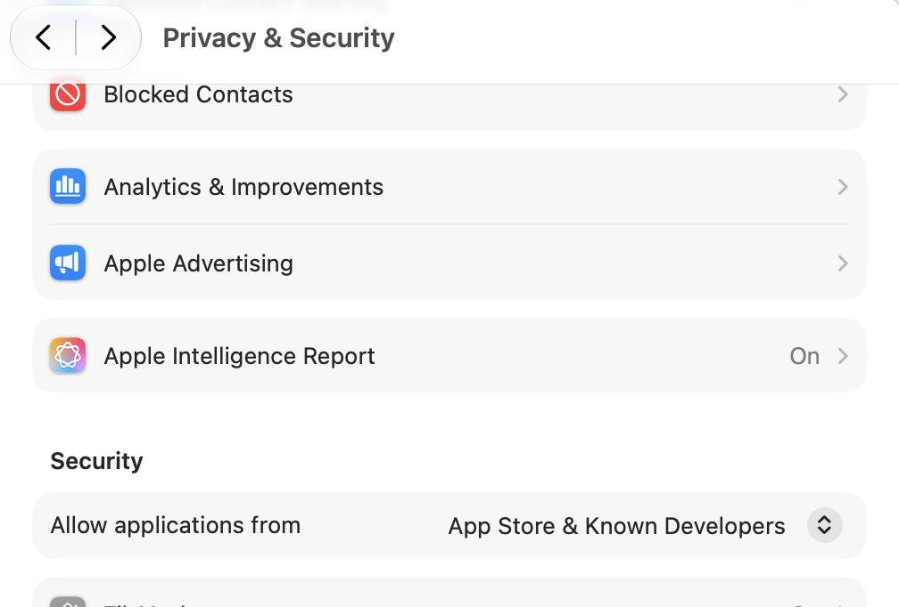

<p align="center">
  
</p>

<h1 align="center">Nodemind</h1>

<p align="center">
  <b>Say what's on your mind. Get a to-do list and a map of your ideas.</b><br>
  Free, open source, and it all runs on your Mac. Nothing is uploaded.
</p>

<p align="center">
  <a href="https://github.com/abhishek085/Nodemind/releases/latest/download/Nodemind-macOS.dmg"><b>⬇ Download for Mac</b></a> ·
  <a href="https://abhishek085.github.io/Nodemind/">Website</a> ·
  <a href="#install-in-3-steps">Install help</a> ·
  <a href="#the-ai-models-it-uses">Models</a> ·
  <a href="assets/video/nodemind-launch.mp4">25-second film</a>
</p>

<p align="center">
  
  
  
  <a href="https://nokast.substack.com"></a>
</p>

<p align="center">
  <a href="assets/video/nodemind-launch.mp4"></a>
</p>

---

## What is it?

You have lots of half-formed thoughts — things to do, questions, ideas, decisions.
Typing them out is a chore, so they stay in your head.

**With Nodemind you just talk.** Hold <kbd>⌥ ⇧ Space</kbd> anywhere on your Mac (or click the
menu-bar icon), ramble, and let go. Nodemind sorts what you said:

| You say… | Nodemind keeps… |
|---|---|
| "I need to call Priya about the invoice tomorrow." | ✓ **Task** → goes on your Today list |
| "We decided to price it at nine dollars a month." | ● **Decision** |
| "I still don't know whether to offer a free tier." | ? **Question** |
| "Maybe we could build an iPhone version." | ✦ **Idea** |
| "Hello, testing, one two three…" | *(nothing — small talk is dropped)* |

Later you can **search** it by meaning ("pricing" finds the price decision), see how your
thoughts **connect on a map**, and spot where you keep getting **stuck** going in circles.
On a call? **Take meeting notes**: it records you and the other side separately and writes
the minutes.

## Install in 3 steps

1. **[Download Nodemind](https://github.com/abhishek085/Nodemind/releases/latest/download/Nodemind-macOS.dmg)** (20 MB, Apple Silicon Macs: M1 or newer).
2. Open the file and drag **Nodemind** into **Applications**.
3. Open it. macOS will warn you the first time — see below. Then wait a few minutes while it downloads its AI models once (about 1.3 GB). After that it works offline.

### Why does macOS warn me? Is the app safe?

macOS shows *"Nodemind can't be opened"* because the app is **not signed with an Apple
Developer certificate**. Apple only removes the warning for apps whose makers pay
**$99 a year** and send each release to Apple for scanning ("notarization"). Nodemind is a free
open-source project and hasn't done that yet. The warning means *"Apple hasn't reviewed this"*,
not *"this is harmful"*. You can check for yourself: [every line of code is here](src-tauri/src),
and the app never sends your voice or notes anywhere.

**To open it anyway:**

1. Double-click Nodemind. When macOS blocks it, click **Done** (not "Move to Trash").
2. Open **System Settings → Privacy & Security** and scroll to the **Security** section.
3. You'll see *"Nodemind was blocked…"* with an **Open Anyway** button. Click it and enter your password.

<p align="center">
  
</p>

> The old "right-click → Open" trick no longer works on recent macOS (15 and later).
> You only need to do this once.

**Prefer one command?** This downloads the app with `curl`, which macOS doesn't flag, so there's
no warning at all. [Read the script first](scripts/install.sh) if you like:

```sh
curl -fsSL https://raw.githubusercontent.com/abhishek085/Nodemind/main/scripts/install.sh | bash
```

## What you get

- **Menu-bar app** — click the icon to record, or hold <kbd>⌥ ⇧ Space</kbd> from any app. The full window opens only when you want the map or your list.
- **Live transcription** — words appear as you talk; the result is ready about a fifth of a second after you stop.
- **A clean checklist** — only real tasks, no duplicates; undo any that are wrong.
- **Ideas, questions, decisions, learnings** — sorted for you, shown on Today and the mind map.
- **Search by meaning** (<kbd>⌘ K</kbd>) — finds what you said even in different words, and says "nothing about that yet" instead of guessing.
- **Mind map** — your ideas linked to their topics and to similar ideas from other days; recurring fog shows up as a hub.
- **Fog check** — notices when you're going round in circles and asks one question to get you unstuck.
- **Meeting notes** — you and the call, labelled *You* / *Them*, with minutes and your action items.
- **Private** — see below.

## The AI models it uses

Nodemind downloads three open models the first time it starts (about 1.3 GB, checked against a
fixed checksum). Nothing is sent to any server after that.

| Job | Model | Size | Link |
|---|---|---|---|
| Speech → text | **Whisper small** (OpenAI, via whisper.cpp) | 488 MB | [ggerganov/whisper.cpp](https://huggingface.co/ggerganov/whisper.cpp/blob/main/ggml-small.bin) |
| Topics, people, meeting minutes | **Qwen3.5 0.8B** (Q4_K_M, Apache-2.0) | 533 MB | [unsloth/Qwen3.5-0.8B-GGUF](https://huggingface.co/unsloth/Qwen3.5-0.8B-GGUF) |
| Search and "similar idea" links | **EmbeddingGemma 2** (Google, Q8_0) | 310 MB | [ggml-org/embeddinggemma-2-GGUF](https://huggingface.co/ggml-org/embeddinggemma-2-GGUF) |

EmbeddingGemma 2 is the heart of search and the map: it turns each statement into numbers
so that ideas with the same *meaning* land close together, even if the words differ.

## Privacy, stated plainly

- Your voice is processed in memory on your Mac and discarded after each recording.
- Your notes live in one local database: `~/Library/Application Support/com.nokast.nodemind/` (open it from Settings).
- The only network use: the one-time model download, and an optional check for new versions. No accounts, analytics, or cloud AI.
- Meeting mode records the call audio playing on your Mac, so **tell people you're taking notes**.

## How it works (for the curious)

```text
voice ─▶ live utterances ─▶ Whisper ─▶ transcript
                                          │
        sort (rules): task · idea · learning · question · decision   ◀── small talk dropped
        fog check (rules + model) · topics & people (Qwen) · minutes (meetings)
                                          │
        tasks ─▶ Today (duplicates skipped)        items ─▶ mind map + EmbeddingGemma 2 search
```

| Layer | Tech |
|---|---|
| App | [Tauri 2](https://tauri.app) (Rust) + React 19 + Tailwind v4 |
| Speech | `whisper-server` (whisper.cpp v1.9.5, Metal), kept loaded for live transcription |
| Reasoning | `llama-server` (llama.cpp b11609, Metal) running Qwen3.5 0.8B |
| Search & links | EmbeddingGemma 2 vectors in SQLite, median-lift ranking + keyword boost |
| macOS bridge | `nodemind-helper` (Swift): EventKit calendar and the call-audio tap |

More detail: [Technical_design.md](Technical_design.md) · [HowItWorks.md](HowItWorks.md).

## Build from source

Needs an Apple Silicon Mac with Xcode command-line tools, Rust, Node 18+ and cmake.

```sh
npm install
./scripts/build-sidecars.sh          # whisper.cpp + llama.cpp + the Swift helper
npx tauri dev                        # run it (models download on first start)

# release build (DMG in src-tauri/target/release/bundle/dmg/)
export TAURI_SIGNING_PRIVATE_KEY="$PWD/src-tauri/nodemind.key"   # generate: npx tauri signer generate
npx tauri build
```

The updater's private key (`src-tauri/nodemind.key`) is git-ignored. If you fork, generate your
own keypair and update `plugins.updater.pubkey` in `tauri.conf.json`. To re-render the launch
film: `cd video && npm i && npm run render`.

## Repository layout

```
├── src/                 # React UI: views (Capture, Today, Search, Mind map, Settings), components
├── src-tauri/src/
│   ├── audio/           # mic, call-audio tap, pause detection, live session
│   ├── engine/          # sort, fog, tasks, links, search, meeting, pipeline, sidecars
│   ├── store/           # SQLite, graph, vector search
│   ├── commands/        # what the UI can ask the backend
│   ├── tray.rs · hotkey.rs
│   └── models/          # pinned model list + resumable downloader
├── src-tauri/native/    # nodemind-helper.swift (calendar + system audio)
├── scripts/             # build-sidecars · release · install
├── site/                # the download page (GitHub Pages)
└── video/               # the launch film (Remotion)
```

## License

MIT — see [LICENSE](LICENSE). A [Nokast](https://nokast.substack.com) project.
