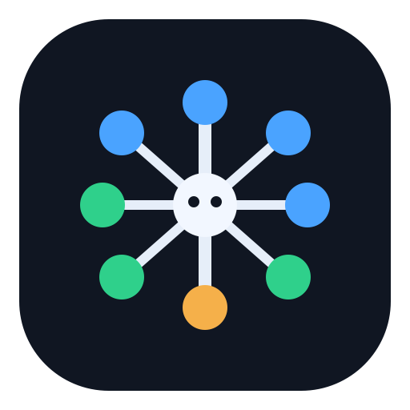

<p align="center">
  
</p>

<h1 align="center">Nodemind</h1>

<p align="center">
  <em>Talk out your messy thoughts. Get a clean mind.</em>
</p>

<p align="center">
  A voice-first, fully local <strong>personal thinking assistant</strong> for macOS.<br />
  Speak — in English or Hindi — and Nodemind turns the ramble into a clean checklist,
  a living thought graph, and a clear view of your day.
</p>

<p align="center">
  
  
  
  
  
</p>

<p align="center">
  <sub>a <strong>Nokast</strong> project</sub>
</p>

---

## 💡 The idea

You have too many half-formed ideas, tasks, and worries bouncing around your head.
Nodemind gives them a place to land:

1. **🎤 Capture** — tap the mic and brain-dump. Messy is fine. English or Hinglish.
2. **🧹 Organize** — a local LLM cleans the transcript, extracts tasks, topics, people,
   and goals, and files them into your mind map.
3. **🗺️ Map** — everything you've ever said becomes a living graph of thoughts,
   topics, people, and goals, linked by what they relate to.
4. **📅 Today** — one screen for the day: your checklist (grouped by the thought it
   came from), a timeline of today's notes and meetings, and your calendar.

There is no account, no cloud, and no telemetry. Your voice is transcribed on your
Mac by a local Whisper model; the reasoning runs on a local 1B LLM. Nothing you say
ever leaves this device.

## ✨ What you get

- **Lives in the menu bar** — click the icon to record and review; the full window opens only for the mind map, Today and settings
- **Hold-to-talk hotkey** — hold <kbd>⌥⇧Space</kbd> anywhere (or tap to start/stop); the result arrives as a notification
- **Live transcription** — speech is transcribed at each pause while you talk, so the transcript is ready ~0.2 s after you stop
- **Meeting notes** — records you (mic) and the call (your Mac's audio output) separately, so every line is labelled *You* / *Them*; when you stop, the local model writes minutes — summary, decisions, action items — and yours land on Today. Works with Zoom, Meet, Teams, anything playing on the Mac (macOS 14.2+)
- **Sorted, not transcribed** — what you say is sorted into tasks, ideas, learnings, questions and decisions; small talk and test chatter are dropped. Tasks go straight to Today (duplicates skipped, undo any)
- **Search by meaning** — EmbeddingGemma 2 searches those clean statements even in different words ("pricing" → "we decided to price it at nine dollars"), with a boost for exact names, and says "nothing about that yet" instead of guessing; <kbd>⌘K</kbd>
- **Mind map** — a force-directed map of your thoughts, the topics and people they share, links between similar thoughts (EmbeddingGemma 2), and recurring fog patterns; hover to trace connections, click for details
- **Direct voice commands** — "remind me to call Sam" becomes a task, even mid-ramble
- **Today view** — your checklist grouped by the thought it came from (no duplicates), a timeline of today's notes and meetings, and your calendar
- **Auto-update** — checks GitHub Releases and relaunches into the new build when you approve

## 🧱 How it's built

| Layer | Tech |
| --- | --- |
| Shell | [Tauri 2](https://tauri.app) (Rust) + React 19 + Tailwind v4 |
| Speech→Text | `whisper-server` (whisper.cpp v1.9.5, Metal) kept loaded for live, per-pause transcription; `whisper-cli` fallback — bundled sidecars |
| Reasoning | `llama-server` (llama.cpp b11609, Metal) hosting Qwen3.5 0.8B (Q4_K_M) — bundled sidecar |
| Memory & search | EmbeddingGemma 2 vectors per idea / question / decision / task (semantic search + similar-item links) + SQLite graph store, all in your app-data folder |
| Calendar | Read-only via EventKit (all accounts, instant), AppleScript fallback |
| macOS bridge | `nodemind-helper` (Swift) — EventKit calendar + Core Audio system-audio tap for meeting mode |
| Distribution | Small DMG; models (~1.6 GB) download once on first launch · signed updater via GitHub Releases |

The two model servers run on loopback (127.0.0.1) only, are spawned by the app, and
are killed when the app exits.

## 🚀 Try it

### Run a prebuilt app

Download the latest **DMG** from [Releases](https://github.com/abhishek085/Nodemind/releases),
drag Nodemind into Applications, and launch it. The first launch downloads the
local AI models once (~1.6 GB); after that Nodemind works with no internet at all.

> **First launch on a Mac that didn't build it** — the app is ad-hoc signed, not
> Apple-notarized, so Gatekeeper will warn on the very first open of a downloaded
> copy: right-click the app → **Open** → **Open** again, and approve it once in
> System Settings → Privacy & Security. Later launches (and in-app updates) are
> seamless.

### Build from source

Requirements: macOS (Apple Silicon), Xcode CLT, Rust, Node 18+, cmake.

```sh
# 1. front-end deps
npm install

# 2. build the whisper.cpp + llama.cpp sidecar binaries
./scripts/build-sidecars.sh

# 3. build the app (produces src-tauri/target/release/bundle/dmg/Nodemind_*.dmg)
#    The models download on first launch, as for users.
export TAURI_SIGNING_PRIVATE_KEY="$PWD/src-tauri/nodemind.key"   # generate: npx tauri signer generate
npx tauri build
```

For day-to-day development, `npx tauri dev` hot-reloads the UI and reuses the same
sidecars and models.

> **About the signing key** — `src-tauri/nodemind.key` (the updater's *private* key)
> is git-ignored by design. The public key is embedded in `tauri.conf.json`. If you
> fork and build, generate your own keypair (`npx tauri signer generate -w src-tauri/nodemind.key --ci`)
> and update `plugins.updater.pubkey` to match.

## 🔒 Privacy, stated plainly

- Audio is buffered in-process, transcribed locally, and discarded after each capture.
- The SQLite database (thoughts, meetings, tasks, graph, vectors) lives in
  `~/Library/Application Support/com.nokast.nodemind/` — open the folder from Settings.
- The only network calls the app can make are: the one-time model download on first
  launch, and the opt-in update check. No analytics, no remote STT, no remote LLM.

## 🗂️ Repository layout

```
├── src/                    # React UI (views, components, lib)
│   ├── lib/                # api (IPC wrappers) · audio (16 kHz worklet) · types
│   ├── views/              # Capture · Graph · Today · Settings
│   └── components/         # Sidebar · StatusBar · SetupScreen · UpdateBanner
├── src-tauri/src/
│   ├── commands/           # the IPC surface the UI talks to
│   ├── engine/             # sidecar lifecycle · whisper · llm · pipeline · prompts
│   ├── store/              # sqlite db · graph · brute-force vector kNN
│   ├── models/             # manifest (sha256-pinned) · resumable downloader
│   ├── calendar/           # read-only Apple Calendar bridge
│   └── lib.rs              # window, tray, menu, exit wiring
├── scripts/
│   └── build-sidecars.sh   # whisper.cpp v1.9.5 + llama.cpp b11609 (Metal, static)
└── src-tauri/resources/    # prompts.toml + bundled models
```

## 📄 License

MIT — see [LICENSE](LICENSE).
